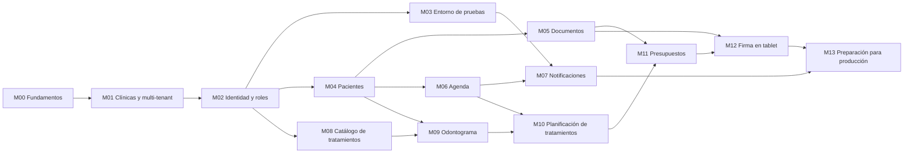

# Plan del MVP de Dentasoft

El MVP se construye en **14 módulos funcionales** que se desarrollan en orden. Cada módulo tiene su fichero en esta carpeta con objetivo, alcance, modelo de datos y tareas numeradas con criterios de aceptación. Lo que queda fuera del MVP está en [`backlog-post-mvp.md`](backlog-post-mvp.md). El apartado de Configuración (secciones, permisos por rol y qué tarea construye cada sección) está en [`configuracion.md`](configuracion.md).

## Orden de desarrollo



## Estado de los módulos

| Módulo | Nombre | Depende de | Estado |
| --- | --- | --- | --- |
| [M00](M00-fundamentos.md) | Fundamentos técnicos | — | En curso |
| [M01](M01-clinicas-multitenant.md) | Clínicas y multi-tenant | M00 | Pendiente |
| [M02](M02-identidad-roles.md) | Identidad, usuarios y roles | M01 | Pendiente |
| [M03](M03-entorno-pruebas.md) | Entorno de pruebas y despliegue continuo | M02 | Pendiente |
| [M04](M04-pacientes.md) | Pacientes | M02 | Pendiente |
| [M05](M05-documentos.md) | Documentos | M04 | Pendiente |
| [M06](M06-agenda.md) | Agenda y citas | M04 | Pendiente |
| [M07](M07-notificaciones.md) | Notificaciones (email y WhatsApp) | M03, M06 | Pendiente |
| [M08](M08-catalogo-tratamientos.md) | Catálogo de tratamientos y hallazgos | M02 | Pendiente |
| [M09](M09-odontograma.md) | Odontograma 2D y 3D | M04, M08 | Pendiente |
| [M10](M10-planificacion-tratamientos.md) | Planificación de tratamientos | M06, M09 | Pendiente |
| [M11](M11-presupuestos.md) | Presupuestos | M05, M10 | Pendiente |
| [M12](M12-firma-tablet.md) | Firma en tablet (Expo) | M05, M11 | Pendiente |
| [M13](M13-produccion.md) | Preparación para producción | Todos | Pendiente |

Algunos módulos pueden avanzar en paralelo cuando sus dependencias están listas (por ejemplo, M05, M06 y M08 tras M04 y M02). M03 se adelanta a M07 porque los webhooks de WhatsApp y Resend necesitan una URL pública.

## Cómo se escriben las tareas

Cada tarea es un bloque con este formato (el script de sincronización depende de él):

```markdown
### M04-T02 · Búsqueda de pacientes

- **Estado**: pendiente | en curso | hecho
- **Depende de**: M04-T01
- **Descripción**: qué hay que construir, en dos o tres frases.
- **Criterios de aceptación**:
  - [ ] Comportamiento comprobable 1
  - [ ] Comportamiento comprobable 2
```

- El ID es `Mxx-Tyy` y no cambia nunca, aunque se reordenen las tareas. Las tareas nuevas toman el siguiente número libre del módulo.
- Las tareas van en la sección `## Tareas` del módulo; cualquier otra sección `##` termina la lista.
- Una tarea debería caber en uno o dos días de trabajo. Si es más grande, se divide.

## Markdown y GitHub Issues

- **Estos ficheros son la especificación**: qué hay que hacer y cómo se comprueba. Se revisan en pull request como el código.
- **GitHub Issues es el tablero**: un issue por tarea, un milestone por módulo y la etiqueta `modulo:Mxx`, para seguir el día a día en un Project de GitHub.
- Para crear o completar los issues a partir de los ficheros:

```powershell
winget install GitHub.cli     # una sola vez
gh auth login                 # una sola vez
.\scripts\sync-issues.ps1 -DryRun        # muestra qué crearía
.\scripts\sync-issues.ps1                # crea milestones, etiquetas e issues que falten
.\scripts\sync-issues.ps1 -Modulo M04    # solo un módulo
```

El script no duplica: si ya existe un issue cuyo título empieza por el ID de la tarea, lo salta. Si has cambiado la descripción o los criterios de tareas que ya tienen issue, añade `-Update` para reescribir sus cuerpos con el texto actual del plan (no toca título, estado ni etiquetas).

- El ciclo de cada tarea (tomar el issue, rama, PR en borrador con `Closes #N`, cierre al fusionar) está en [`AGENTS.md`](../../AGENTS.md#flujo-de-trabajo-con-github-issues). En el mismo PR se cambia el **Estado** de la tarea a `hecho` en su fichero; al terminar un módulo, se actualiza su fila en la tabla de arriba.
- El tablero es el Project **Dentasoft MVP** (columnas Pendiente, En curso, En revisión y Hecho), que se mueve solo con los issues y PR.

## Definición de terminado

Ver [`AGENTS.md`](../../AGENTS.md#definición-de-terminado). En resumen: criterios de aceptación cumplidos, tests y CI en verde, reglas de multi-clínica, seguridad e i18n respetadas, y documentación actualizada.
